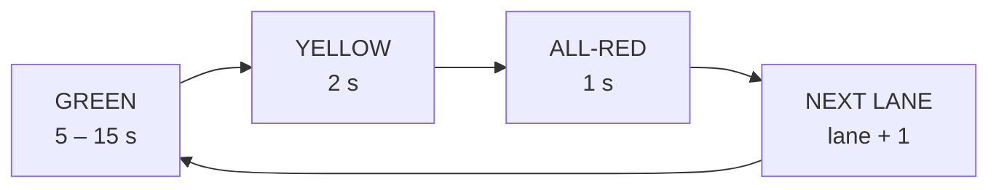

<div align="center">

# 🚦 Adaptive Traffic Signal Controller

**A 4-lane, queue-based traffic signal on an STM32 (bare-metal, register-level C) that adapts green time to real-time vehicle counts, with pedestrian and emergency-vehicle priority.**


-success)

</div>

---

## 📌 Overview

Fixed-timer signals give an empty lane the same green time as a congested one, which wastes time, fuel, and patience. This project replaces fixed timers with **real-time queue estimation**: IR sensors count vehicles entering and leaving each lane, and the firmware converts the queue length into a green duration.

It also handles two cases that fixed timers ignore:

- **Pedestrians:** a crossing request with an extended mode for slower walkers.
- **Emergency vehicles:** a dedicated priority phase for ambulances and fire trucks.

Built as a Microprocessor Lab project at MIT Manipal, running entirely on a ~$2 Blue Pill board with no HAL and no RTOS.

---

## ✨ Key Features

| Feature | Details |
|---|---|
| **Queue-based green time** | 2 IR sensors per lane (IN and OUT) keep a live queue count (0–20). Green time = `min(15, 5 + 2 × queue)` seconds. |
| **Non-blocking state machine** | A 1 ms SysTick timebase drives Green → Yellow (2 s) → All-Red (1 s) → next lane, with no `delay()` calls. |
| **Safe emergency priority** | An EXTI interrupt sets a flag. At the next safe point the controller finishes the current phase, then gives the emergency lane 12 s of green (display shows `E 12` counting down). |
| **Pedestrian crossing** | A button press extends the walk phase to at least 9 s. Pressing 3 times within 3 s activates **elderly mode** (12 s). |
| **Audio feedback** | One buzzer: single beep for a press, three beeps for elderly mode, slow tick during walk, rapid tick during flashing clearance. |
| **Per-lane countdown** | Four TM1637 7-segment displays show `--` during extension, `9…1` during countdown, `00` during yellow, and blank during red. |
| **Status LCD** | A 16x2 I²C LCD shows the active lane, phase, remaining time, live queue counts, and flags (`P` pedestrian, `S` elderly mode). |
| **Serial telemetry** | USART1 streams queue counts as `L1=..,L2=..,L3=..,L4=..` (115200, 8N1) for non-intrusive debugging. |

---

## 🧠 How It Works

### Signal cycle



### Queue estimation

Each lane has an **IN** sensor at the start of the stretch and an **OUT** sensor at the stop line. A vehicle is counted once, on a debounced clear → blocked transition (3 samples at 20 ms).

```
Q = max(0, min(20, Q + IN − OUT))
```

### Green time

```
green_time = min(15 s, 5 s + 2 s × queue_length)
```

| Queue length | 0 | 1 | 2 | 3 | 4 | 5+ |
|---|:-:|:-:|:-:|:-:|:-:|:-:|
| **Green time (s)** | 5 | 7 | 9 | 11 | 13 | 15 |

### Interrupts and priority handling

Button presses trigger EXTI interrupts that **only set flags**. The main loop checks those flags at predefined safe points, never during yellow, so signals never change abruptly. Pedestrian and emergency requests are served after the current Green → Yellow → All-Red sequence completes.

---

## 🔧 Hardware

| Component | Qty | Purpose |
|---|:-:|---|
| STM32F103C8T6 (Blue Pill) | 1 | Main controller |
| ST-Link V2 | 1 | Programming and debugging (SWD) |
| LEDs (Red / Yellow / Green) + 220–330 Ω resistors | 12 | Signal heads, 3 per lane × 4 lanes |
| IR obstacle-detection modules | 8 | Vehicle IN/OUT counting, 2 per lane |
| TM1637 4-digit display modules | 4 | Per-lane countdown |
| 16x2 LCD with I²C backpack | 1 | System status |
| PCF8574T I²C expanders | 2 | Extra I/O (lane 3 and 4 sensors, pedestrian buttons, crossing LEDs) |
| Push buttons | 8 | Emergency and pedestrian requests |
| Buzzer | 1 | Audible feedback |
| UART-to-TTL module | 1 | Serial monitoring |

> **Why active IR modules?** Passive IR (PIR) sensors detect moving warm bodies, not a stationary vehicle at a fixed point, so they are unsuitable for queue detection.

<!-- TODO: add your verified pin mapping here, taken from Src/ -->

---

## 💻 Software and Tools

- **Language:** C, **register-level** using CMSIS device headers (no HAL, no RTOS)
- **IDE:** STM32CubeIDE
- **Flashing:** STM32CubeProgrammer via ST-Link V2 (SWD-only mode, which frees PB3/PB4 for buttons)
- **Debugging:** UART terminal for live counts, events, and fault messages
- **Version control:** Git and GitHub

---

## 📂 Repository Structure

```
├── Inc/                      # Header files
├── Src/                      # Application source
├── Startup/                  # MCU startup code
├── STM32F103C8TX_FLASH.ld    # Linker script
└── README.md
```

---

## 🚀 Getting Started

1. **Clone the repo**
   ```bash
   git clone https://github.com/Saksham2607/adaptive-traffic-signal-stm32.git
   ```
2. Open **STM32CubeIDE** → **File → Open Projects from File System** → select the cloned folder.
3. Build with **Project → Build All**.
4. Connect the Blue Pill via **ST-Link V2** and flash using STM32CubeProgrammer or **Run → Debug**.
5. Open a serial terminal at **115200 baud, 8N1** on USART1 to see live queue counts.

---

## 🧪 Testing and Results

| Area | What was checked | How |
|---|---|---|
| 4-lane LED sequencing | Correct Green → Yellow → All-Red order, safety gaps | On hardware |
| Non-blocking timing | Signals run continuously while other tasks execute | On hardware |
| Counting and timing logic | Queue counting rules and green-time output for various queue lengths | Offline firmware testing; zero compiler warnings |
| Displays | LCD shows lane, phase, and queues correctly; all 4 TM1637 countdowns match remaining time with no interference on the shared clock line | On hardware |
| Emergency and pedestrian | Priority phases and buzzer behavior | On hardware |

---

## ⚠️ Limitations and Future Work

**Current limitations**

- **Count drift:** the queue is estimated from IN/OUT events, so a missed or double-counted vehicle can skew a lane until it clears.
- **IR noise:** ambient light and sensor placement can cause false triggers (debouncing reduces this).
- **Fixed lane order:** lanes are served round-robin, and only the green duration adapts.
- **Queue cap of 20 and a 15 s maximum green** are prototype parameters, and the 2 s per vehicle value is a starting value still to be tuned.
- **Prototype scale:** breadboard model, not tested on real traffic, and no quantitative comparison against a fixed-timer baseline yet.

**Next steps**

- Measure average wait time against a fixed-timer baseline
- Add sensor fault detection and periodic queue recalibration
- Wi-Fi / cloud dashboard for remote monitoring and emergency logs
- Camera-based counting to improve accuracy and detect vehicle types
- Synchronized multi-intersection control
- Solar power with battery backup

---

## 👤 My Contribution
Green time min and max time allocation, queue and timing logic, interrupt handling, displays, hardware assembly, testing

---

## 🛠 Skills Demonstrated

`Embedded C` · `STM32 / ARM Cortex-M3` · `Bare-metal / register-level programming` · `SysTick and non-blocking state machines` · `EXTI interrupts` · `I²C` · `UART` · `Sensor interfacing and debouncing` · `Real-time system design`

---


<div align="center">

**Built by [Saksham](https://github.com/Saksham2607)**

</div>
